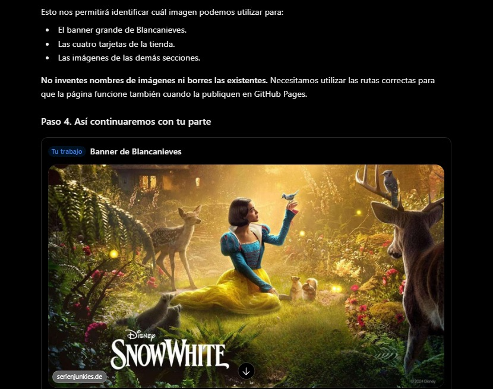
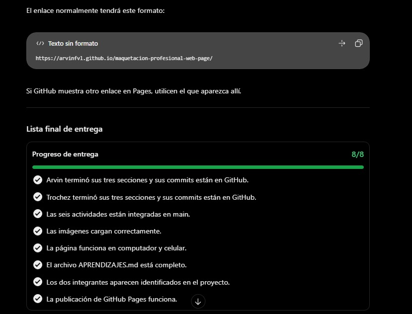

# Proyecto de Maquetación Web Disney

## 1. Descripción del proyecto

Este proyecto consiste en desarrollar una página web inspirada en el diseño visual de Disney, utilizando HTML y CSS.

El objetivo fue practicar la estructura de páginas web, la organización de contenido, el diseño visual y la adaptación a diferentes dispositivos.

## 2. Integrantes

- Arvin Fajhet Villota López
- Juan David Trochez Cerón

## 3. Distribución del trabajo

### Arvin Fajhet Villota López

1. Desarrollo de la barra de navegación.
2. Diseño del banner principal de Blancanieves.
3. Creación de las cuatro tarjetas de Disney Shop.

### Juan David Trochez Cerón

1. Creación de las tres tarjetas Explore More Disney.
2. Desarrollo de las cinco tarjetas Coming Soon.
3. Creación de las tarjetas Disney Parks, la promoción final y el footer.

Los integrantes también participaron en la revisión e integración de las secciones.

## 4. Aprendizajes

Durante el desarrollo del proyecto aprendimos:

- Crear estructuras semánticas utilizando HTML.
- Aplicar estilos mediante CSS.
- Organizar los archivos de un proyecto web.
- Utilizar imágenes locales dentro de una página.
- Crear tarjetas y distribuciones mediante CSS Grid.
- Utilizar Flexbox para organizar elementos.
- Implementar diseños adaptables mediante media queries.
- Trabajar con Git y GitHub.
- Crear ramas, realizar commits e integrar cambios.
- Trabajar colaborativamente en un mismo repositorio.

## 5. Dificultades encontradas

Durante el desarrollo encontramos dificultades relacionadas con:

- La organización de los elementos para acercarnos al diseño de referencia.
- La ubicación y utilización correcta de las imágenes.
- El ajuste de tamaños, márgenes y espacios.
- La adaptación del diseño a pantallas pequeñas.
- La sincronización de cambios entre los integrantes mediante Git.

Estas dificultades se solucionaron revisando el código, realizando pruebas en el navegador y trabajando de manera organizada con ramas.

## 6. Uso de inteligencia artificial

Utilizamos ChatGPT como herramienta de apoyo durante el desarrollo.

La inteligencia artificial nos ayudó a:

- Comprender la estructura de HTML y CSS.
- Orientar la creación de las secciones de la página.
- Identificar los estilos necesarios para organizar las tarjetas.
- Comprender los comandos de Git y GitHub.
- Resolver dudas sobre la organización del proyecto.
- Revisar posibles errores y mejorar la presentación visual.

Las sugerencias generadas por inteligencia artificial fueron revisadas, adaptadas e implementadas por los integrantes.

### Interacciones con inteligencia artificial

Se utilizaron consultas relacionadas con:

1. Creación de la estructura HTML de la página.
2. Desarrollo de los estilos CSS de las diferentes secciones.
3. Organización del trabajo en ramas de Git.
4. Integración de los aportes de los dos integrantes.
5. Visualización y revisión del proyecto en el navegador.

## 7. Trabajo colaborativo

El proyecto se desarrolló utilizando Git y GitHub.

Cada integrante trabajó en ramas independientes y realizó commits para registrar sus aportes. Posteriormente, las ramas fueron integradas en la rama principal `main`.

También se realizaron revisiones del código y pruebas de funcionamiento para comprobar la integración de las secciones.

## 8. Conclusión

Este proyecto permitió fortalecer nuestros conocimientos de HTML, CSS, diseño responsive y control de versiones.

Además, aprendimos la importancia de organizar las tareas, trabajar colaborativamente y utilizar herramientas digitales como apoyo en el desarrollo web.

---

Proyecto académico. No es un sitio oficial de Disney.

